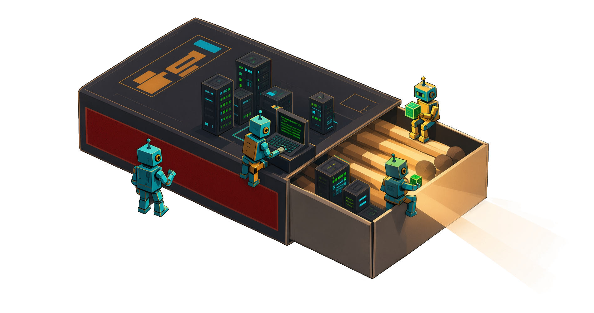

# ai-korobok

**Your AI agents, in a box.**



`ai-korobok` spins up a disposable QEMU/libvirt VM preloaded with Python, Node.js, and
Docker — a safe, throwaway sandbox for running AI agents, MCP servers, and whatever else
you don't want loose on your host. KVM-accelerated when available, TCG when not, with
real-time host↔VM file sharing and host port forwarding baked in.

> Create it. `ssh` in. Run your agents. `destroy` it. No muss, no leftover state.

## Quick Start

```bash
# 1. Install host dependencies (run once, requires root)
sudo ./setup.sh

# 2. Log out and back in (for libvirt group membership)

# 3. Create your config from the example
cp config.example.json config.json
# Edit config.json to your preferences (optional)

# 4. Create and start the VM
./vm.sh create

# 5. SSH into the VM
./vm.sh ssh
```

## Prerequisites

- Linux host: Ubuntu/Debian or Fedora, macOS, or Windows via WSL2
  (see [macOS Support](docs/macos.md) / [Windows Support](docs/windows.md))
- Root/sudo access for initial setup
- ~2GB free disk for cloud image + configured disk size
- Internet connection for downloading the cloud image and VM packages
- Ansible (auto-installed by `setup.sh` if missing; not needed on macOS)

## macOS Support

macOS hosts are supported through a Homebrew-based setup path; see
[docs/macos.md](docs/macos.md) for installation steps and current limitations.

## Windows Support

Windows is supported via WSL2; libvirt and QEMU run inside the WSL2 Linux distribution.
See [docs/windows.md](docs/windows.md) for setup steps, KVM/nested-virtualization
details, and limitations.

## Commands

| Command                 | Description                                                                 |
| ----------------------- | --------------------------------------------------------------------------- |
| `./vm.sh create`        | Download cloud image, generate cloud-init, create disk, define and start VM, then wait for provisioning |
| `./vm.sh start`         | Start an existing stopped VM                                                |
| `./vm.sh stop`          | Graceful ACPI shutdown (60s timeout, then force)                            |
| `./vm.sh destroy`       | Force stop + undefine + delete disk images + cleanup                        |
| `./vm.sh ssh`           | SSH into the VM using auto-generated key                                    |
| `./vm.sh backup-agent [archive]` | Sync agent state from the VM and write a portable archive          |
| `./vm.sh restore-agent <archive> [--force]` | Restore agent state into the host and VM                 |
| `./vm.sh install-lancedb` | Install LanceDB + opencode-indexing plugin in a running VM               |
| `./vm.sh install-e2e-deps` | Install QEMU/libvirt in a running VM for nested e2e runs                 |
| `./vm.sh status`        | Show VM state, IP, resource usage, port forwards                            |
| `./vm.sh export`        | Package qcow2 + XML + config + keys into a tarball                          |
| `./vm.sh import <file>` | Unpack tarball, define domain, ready to start                               |
| `./vm.sh list-ports`    | Show configured port forwarding rules                                       |

### LanceDB + opencode-indexing

`./vm.sh install-lancedb` installs the Python `lancedb` package and the
`@javierkaiser/opencode-indexing` OpenCode plugin (embedded LanceDB semantic
index) into a running VM. It requires OpenCode v2 (`@opencode/cli`), installs it
if needed, and runs the plugin installer as the `ubuntu` user so it writes
`~/.config/opencode/indexing.json` and registers with `opencode plugin add`.
Newly created VMs already get both via cloud-init; use this command to
add them to an existing VM. It is idempotent — safe to re-run.

### Running e2e inside the VM

The guest also contains QEMU/libvirt, so destructive VM lifecycle checks can run
inside `ai-vm` against a nested VM instead of on the host. Fresh VMs get the
dependencies from cloud-init; for an existing VM run:

```bash
./vm.sh install-e2e-deps
./vm.sh ssh    # reconnect so ubuntu picks up the kvm/libvirt groups
```

Inside the guest, copy the project to guest-local storage (not the virtiofs
mount) and use a small, non-conflicting config. Keep `disk_path` under
`/var/lib/libvirt/images/`: libvirt runs QEMU as `libvirt-qemu`, which cannot
traverse a `750` home directory, and that directory is root-owned, so `vm.sh`
creates the overlay through `sudo`. The cloud image is cached in
`/var/lib/libvirt/images/cache` by default.

```bash
mkdir -p /tmp/ai-korobok-e2e
tar -C /mnt/workspace/emulator \
  --exclude=./.state --exclude=./.venv --exclude=./keys --exclude=./config.json \
  -cf - . | tar -C /tmp/ai-korobok-e2e -xf -
cd /tmp/ai-korobok-e2e
jq 'del(.shared_dir)
    | .vm_name="ai-vm-e2e"
    | .disk_path="/var/lib/libvirt/images/ai-vm-e2e.qcow2"
    | .vcpus=2
    | .memory_mb=2048
    | .disk_gb=16
    | .port_forwards=[{"host":2223,"guest":22,"protocol":"tcp"}]
    | .opencode_persistence.enabled=false' config.example.json > config.json
./vm.sh create
./vm.sh ssh
./vm.sh destroy
```

Nested boot is slower than bare metal; `create` gives the guest up to three
minutes to obtain a DHCP lease before giving up on the IP (and then skips the
provisioning wait). The iptables rules for port forwarding are applied through
`sudo -n`, so run `vm.sh` as a normal user with `sudo` access, not as root.

`/dev/kvm` must be present and writable. If the host does not expose nested
virtualization, the nested VM falls back to TCG (much slower). `setup.sh` writes
the `kvm_intel.nested=1` / `kvm_amd.nested=1` module option best-effort; a reboot
is required if a VM is already using the module. If the current SSH session
predates the group change, reconnect or run nested commands with
`sg kvm -c './vm.sh create'`.

### Provisioning wait

`./vm.sh create` waits for cloud-init to finish installing guest dependencies
(Node.js, Docker, Python packages, LanceDB, OpenCode) before it prints the success
message. While it waits it prints the current `>>>` step from
`/var/log/cloud-init-output.log`, so a long package install looks like progress
rather than a hang.

Cloud-init reboots the VM when provisioning finishes; the wait follows the reboot,
re-resolves the VM IP, and re-applies port forwards if the address changed. The
guest writes `/var/lib/ai-korobok/provisioned` as its completion marker, so a
re-run against an already provisioned VM returns immediately.

```bash
./vm.sh create              # wait (default)
./vm.sh create --no-wait    # return once the VM has an IP
./vm.sh create --timeout 3600
```

If provisioning takes longer than `provisioning.timeout_seconds` (default 1800),
`create` leaves the VM running, prints a warning, and exits 0. Check progress with
`./vm.sh status` (shows `starting`, `in progress (<step>)`, or `complete`) or in the
guest with `cloud-init status --long` and
`tail -f /var/log/cloud-init-output.log`. `./vm.sh ssh` also warns when
provisioning is still running.

## Agent State Persistence

OpenCode config, credentials, sessions, and (optionally) agent tooling are kept on
the host, so `vm.sh destroy` and `vm.sh create` do not lose them. Syncing happens
automatically:

- `create` restores the host copy after cloud-init provisioning finishes.
- `start` restores it once SSH is available.
- `stop` and `destroy` sync from the guest before shutting down or deleting the
  disk (`destroy` leaves the host copy untouched when the VM is already gone).

The host copy is a directory (default `~/.local/share/ai-korobok/opencode`, mode
`0700`) containing `guest/` (files mirroring their guest paths) and
`manifest.json`. OpenCode paths are resolved in the guest with
`opencode debug paths`, falling back to the standard `~/.config/opencode`,
`~/.local/share/opencode`, `~/.local/state/opencode`, and `~/.cache/opencode`.

### Profiles

| Profile | Contents |
| --- | --- |
| `minimal` | OpenCode config, data, and state. |
| `agent` (default) | `minimal` plus SSH/Git/gh/npm/pip/cloud credentials, dotfiles and shell history, fish/systemd user config, `~/.local/bin`, MCP state, the LanceDB index, and the user crontab. |
| `full` | `agent` plus OpenCode, Hugging Face, Ollama, npm, pip, uv, Go module, and Playwright caches. Docker volumes only when `include_docker_volumes` is enabled. |

`include_cache` defaults to `false` for `minimal`/`agent` and to `true` for `full`
unless explicitly set. `include_docker_volumes` only applies to `full` and exports
each volume best-effort via the guest's Docker storage.

### Portable backups

```bash
./vm.sh backup-agent                              # opencode-agent-<vm>-<timestamp>.tar.gz
./vm.sh backup-agent /safe/place/agent-backup.tar.gz
./vm.sh restore-agent /safe/place/agent-backup.tar.gz          # refuses non-empty state
./vm.sh restore-agent /safe/place/agent-backup.tar.gz --force
```

`backup-agent` syncs from a running VM first, or uses the host copy when the VM is
gone. The archive contains `manifest.json` (format version, timestamp, source VM,
OpenCode version, profile, included paths) and the mirrored files. It is written
with mode `0600`. `restore-agent` validates the manifest, restores the host copy,
and pushes into a running VM immediately; otherwise the state is applied on the next
`create`/`start`.

> **Security:** archives include credentials, SSH keys, and session history. Keep
> them `0600`, never commit or upload them, and prefer encrypted storage. The
> guest's `authorized_keys` is excluded from sync and restore so an old archive
> cannot lock you out.

### Configuration

```json
"opencode_persistence": {
  "enabled": true,
  "host_path": "~/.local/share/ai-korobok/opencode",
  "backup_profile": "agent",
  "include_cache": false,
  "include_docker_volumes": false
}
```

Set `enabled` to `false` to disable the automatic create/start/stop/destroy syncs
(explicit `backup-agent`/`restore-agent` still work). `host_path` must be absolute
or start with `~/`; relative paths are resolved against the project directory.

## Configuration

Edit `config.json` to customize the VM:

```json
{
  "vm_name": "ai-vm",
  "vcpus": 4,
  "memory_mb": 8192,
  "disk_gb": 50,
  "disk_path": "/var/lib/libvirt/images/ai-vm.qcow2",
  "shared_dir": {
    "host_path": "/home/dev/ai-workspace",
    "mount_tag": "ai-workspace",
    "mount_point": "/mnt/workspace"
  },
  "port_forwards": [
    { "host": 2222, "guest": 22, "protocol": "tcp" },
    { "host": 8080, "guest": 80, "protocol": "tcp" },
    { "host": 3000, "guest": 3000, "protocol": "tcp" },
    { "host": 3001, "guest": 3001, "protocol": "tcp" }
  ],
  "network": {
    "type": "nat",
    "wifi_interface": "wlp0s20f3"
  },
  "provisioning": {
    "wait": true,
    "timeout_seconds": 1800
  },
  "opencode_persistence": {
    "enabled": true,
    "host_path": "~/.local/share/ai-korobok/opencode",
    "backup_profile": "agent",
    "include_cache": false,
    "include_docker_volumes": false
  },
  "gpu_passthrough": false,
  "os_variant": "ubuntu24.04"
}
```

### Key Fields

- **vcpus**: Number of virtual CPUs (default: 4)
- **memory_mb**: RAM in megabytes (default: 8192)
- **disk_gb**: Disk size in gigabytes (default: 50)
- **shared_dir**: virtiofs host↔VM shared directory
- **port_forwards**: List of host→guest port mappings
- **network**: Networking mode and (optionally) the egress interface; see [Networking](#networking)
- **provisioning**: `wait` (default `true`) and `timeout_seconds` (default 1800) for the cloud-init wait during `create`
- **opencode_persistence**: agent state sync settings; see [Agent State Persistence](#agent-state-persistence)
- **gpu_passthrough**: Set to `true` to pass through a discrete GPU (requires IOMMU)

## Caching

`./vm.sh create` keeps the Ubuntu cloud image in `cache_dir`; `./vm.sh destroy`
leaves it in place, so recreating a VM does not download the image again. The
default is `<disk dir>/cache` (for example `/var/lib/libvirt/images/cache`). Set
`cache_dir` in `config.json` to override it; `~` and relative paths are resolved.
The QEMU user must be able to read the cache, so a libvirt storage directory is
the safest location; a project directory under a `750` home is not.

For nested e2e runs the guest runs `apt-cacher-ng`, and `vm.sh` points new VMs at
it automatically: it reads the default network gateway and probes port 3142.
Override with `apt_proxy` in `config.json` (a `host:port` string), or disable it
with `"apt_proxy": "none"`. Ubuntu archive packages are then served from the
guest's cache instead of being downloaded for every nested VM. HTTPS repos
(NodeSource, Docker) skip the cache via `Acquire::https::Proxy "DIRECT"`, since
apt-cacher-ng does not tunnel `CONNECT` and they are not cached anyway.

`apt_mirror` (empty by default) points new VMs at a different Ubuntu archive, for
example a regional mirror or one reachable when `archive.ubuntu.com` is not. It
is used for both the primary and security suites.

## What's Installed in the VM

The cloud-init provisioning automatically installs:

- Python 3 + pip + venv
- Node.js 22 LTS
- OpenCode v2 CLI (`@opencode/cli`)
- Docker CE + Docker Compose
- Common AI packages: `openai`, `anthropic`, `httpx`, `uvicorn`, `fastapi`, `pydantic`
- LanceDB: `lancedb` + `pyarrow` (Python) and the `@javierkaiser/opencode-indexing`
  OpenCode plugin (embedded LanceDB semantic index, installed for the `ubuntu` user)
- QEMU/libvirt, OVMF, and `cloud-image-utils` for running nested e2e VMs
- Git, curl, htop, ripgrep, build-essential

## Shared Directory

The host directory configured in `shared_dir.host_path` is mounted inside the VM at the configured `mount_point` using virtiofs. Changes are reflected in real-time in both directions.

## Port Forwarding

Port forwards are managed via iptables DNAT rules. They are applied on `create`/`start` and removed on `stop`/`destroy`. Rules are tracked in `.state/iptables-rules` for clean removal.

Default forwards:

- `localhost:2222` → VM `22` (SSH)
- `localhost:8080` → VM `80` (HTTP)
- `localhost:3000` → VM `3000` (app server)
- `localhost:3001` → VM `3001` (MCP server)

## Networking

The `network` block controls how the VM reaches the outside world:

```json
"network": {
  "type": "nat",
  "wifi_interface": "wlp0s20f3"
}
```

- **`type`** — `nat` (default) or `wifi-bridge`
- **`wifi_interface`** — host network interface name; only used when `type` is `wifi-bridge`

Find your interface name with `ip link` (WiFi adapters are usually `wl*`, Ethernet `en*`/`eth*`).

### `nat` (default)

The VM attaches to libvirt's `default` network (`virbr0`, `192.168.122.0/24`). Outbound
traffic follows the **host's routing table**, so it takes whatever path the host uses
(including a VPN). In this mode `wifi_interface` is ignored.

### `wifi-bridge`

Despite the name, this is not a layer-2 bridge — it creates a dedicated libvirt NAT
network (`<vm_name>-wifi`, subnet `192.168.100.0/24`) whose forwarding is pinned to a
specific host interface via `forward dev='<wifi_interface>'`. This forces VM egress out
the named interface instead of following the host's default route.

Requires `wifi_interface` to be set and the interface to exist on the host; otherwise
`vm.sh create` / `vm.sh start` aborts. The name is a bit of a misnomer — an Ethernet
interface works too, as long as the name matches a real interface.

On first boot cloud-init also installs a guest route for the subnet auto-detected on
`wifi_interface` via the wifi-bridge gateway, so LAN devices are reachable from inside
the VM.

### Accessing local network devices with a VPN on the host

If the host has a VPN active, the default `nat` mode sends all VM traffic through the
host's routing table — typically down the VPN tunnel. That means the VM may be unable to
reach local LAN devices (NAS, printers, router admin, other machines), because the VPN
captures the default route and/or blocks LAN access.

To keep local network devices reachable while the host stays on VPN, use `wifi-bridge`
and set `wifi_interface` to the interface actually connected to your LAN (WiFi or
Ethernet):

```json
"network": {
  "type": "wifi-bridge",
  "wifi_interface": "wlp0s20f3"
}
```

VM traffic is then forwarded out that interface, bypassing the host's VPN default route
for the local segment. Note that this pins **all** VM egress to that interface, not just
LAN-bound traffic.

### Host firewall

The VM reaches the internet through the host's `FORWARD` chain. If the host's default
`FORWARD` policy is `DROP` (common with some Docker/firewall setups), the VM will have no
connectivity and port forwards will not work.

On `create`/`start`, `vm.sh` checks the policy and sets `iptables -P FORWARD ACCEPT` when
it is not already `ACCEPT`, then persists the rules using `netfilter-persistent` on
Debian/Ubuntu or `/etc/sysconfig/iptables` on Fedora (installed by `setup.sh`). Run
`vm.sh` with `sudo` so the rules can be saved. If no persistence mechanism is available,
the runtime change still applies but will not survive a reboot.

## KVM Acceleration

If `/dev/kvm` is available, the VM uses hardware acceleration (KVM) for near-native performance. If not available (e.g., running inside a container), the VM falls back to TCG software emulation — functional but noticeably slower.

To check: `ls -la /dev/kvm`

To enable KVM on bare metal:

```bash
sudo modprobe kvm_intel   # Intel CPUs
sudo modprobe kvm_amd     # AMD CPUs
```

## GPU Passthrough

Set `gpu_passthrough: true` in config.json to pass through a discrete GPU. Requirements:

- IOMMU enabled in BIOS
- IOMMU enabled in kernel (`intel_iommu=on` or `amd_iommu=on` in GRUB)
- GPU not in use by the host
- GPU PCI ID detected via `lspci`

## Export/Import

Export a VM for portability:

```bash
./vm.sh export    # creates ai-vm-export-YYYYMMDDHHMMSS.tar.gz
```

Import on another host:

```bash
./vm.sh import ai-vm-export-YYYYMMDDHHMMSS.tar.gz
./vm.sh start
```

`export` packages the disk, domain XML, config, and SSH keys only. It does **not**
include the host agent persistence directory or `backup-agent` archives — copy
those separately if you need the agent state on the new host.

## Changelog

Release notes live in [changelog/README.md](changelog/README.md).

## Project Structure

```
ai-vm-manager/
├── config.example.json  # Example VM configuration (copy to config.json)
├── vm.sh                # Main CLI management script
├── setup.sh             # Host dependency installer (thin wrapper for Ansible)
├── playbooks/
│   └── setup.yml        # Ansible playbook (Fedora + Debian/Ubuntu)
├── cloud-init/
│   ├── user-data        # Cloud-init user-data template
│   └── meta-data        # Cloud-init meta-data template
├── templates/
│   └── domain.xml       # Libvirt domain XML template
├── keys/                # Auto-generated SSH keypair
├── .state/              # Runtime state (created automatically)
│   ├── *.xml            # Generated domain XML
│   ├── *-seed.iso       # Cloud-init seed ISO
│   ├── iptables-rules   # Tracked port forwarding rules
│   └── virtiofsd.pid    # virtiofs daemon PID
├── changelog/           # Release notes (one file per version)
└── README.md
```
